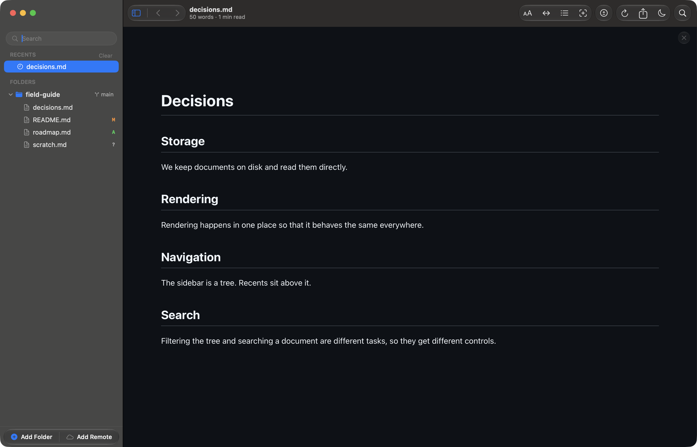
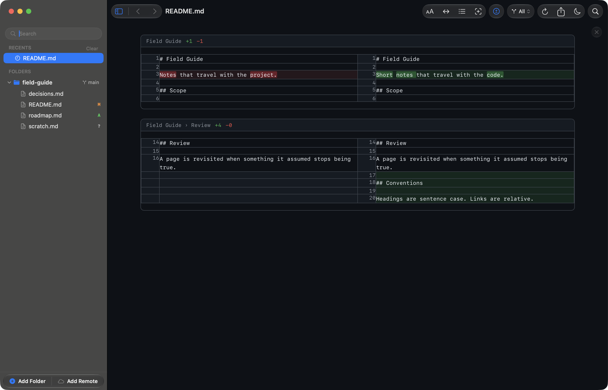
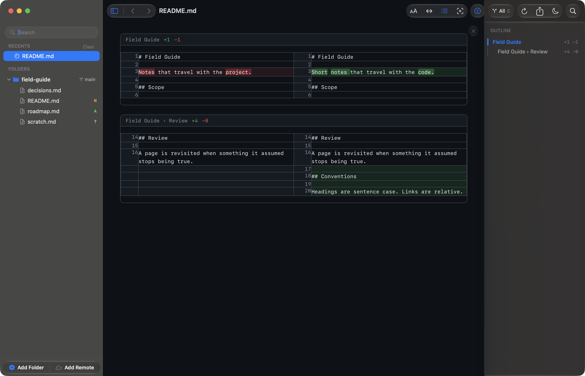
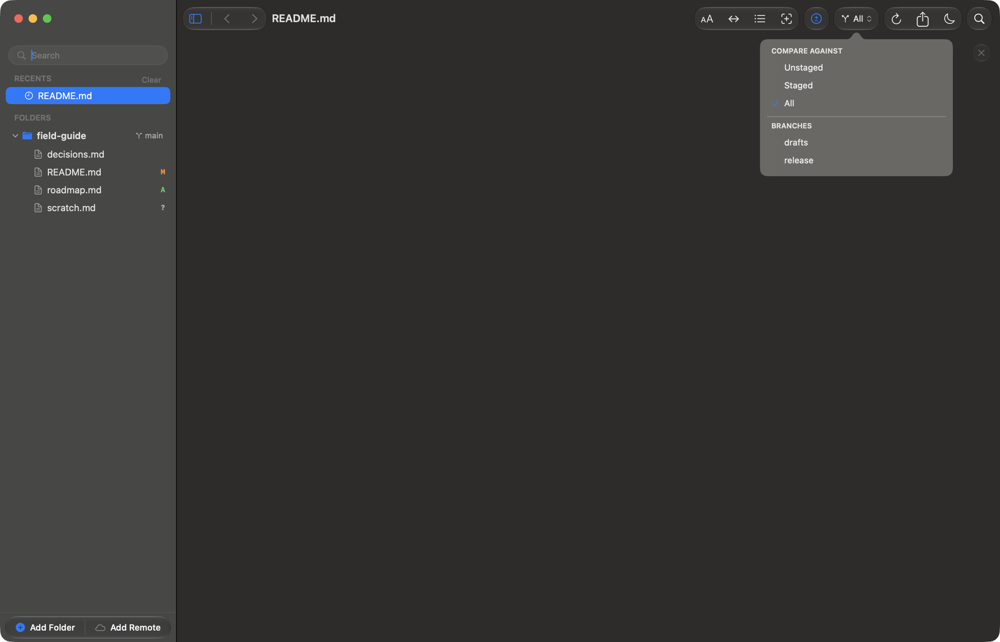

# Working in a git repository

When a folder you add is a git repository, Reader.md notices. Changed files get
a badge in the sidebar, and any document can be read as a diff instead of as
rendered markdown.

Nothing here writes to your repository. Reader.md runs `git` only to read from
it: what changed, and what a branch holds. It never stages, commits, checks out,
or discards anything.

## Change badges

A markdown file with uncommitted changes carries a one-letter badge on its
sidebar row: **M** modified, **A** added, **?** untracked, and **U** for a file
left conflicted by a merge. Folders stay unmarked.

The badges read the index as well as the working tree: stage a new file and its
**?** becomes **A**, without the document itself changing. Edits on disk show up
as they happen. The index is re-checked when Reader.md comes back to the front,
so staging in a terminal lands the moment you switch across.

## Reading a diff

Toggle Diff (⇧⌘D) replaces the rendered document with a side-by-side comparison:
the committed text on the left, yours on the right. Each block of changes is a
hunk. Its header names the section the change falls in and counts the lines
added and removed.

Changed lines are highlighted word by word, so a reworded sentence reads as the
few words that moved rather than as a whole line replaced. Press ⇧⌘D again to go
back to the rendered view.

Diff mode is a setting, not a per-file one: it stays on as you move between
documents, and a file with no changes says so. Outside a repository the control
is not in the toolbar at all.

For the review workflow end to end, see
[Review documentation changes before they merge](../use-cases/review-markdown-changes.md).

## Hunks in the outline

The outline (⇧⌘B) changes with it. In diff mode it lists the changed hunks
instead of the document's headings, each with its own added and removed counts,
and clicking one jumps to it.

## What the diff compares against

The control beside the diff button names what you are comparing against, and
opens the list of choices. **Unstaged** is what you have not staged yet,
**Staged** is what you have, and **All** is everything since the last commit.
All is the default.

Under those sit the repository's branches. Picking one compares your working
copy — uncommitted edits included — against that branch's tip. That is how you
read a document as it will look after a merge. A repository with a long list of
branches gets a filter field above the list.

The scope applies to whatever you open next, so you can set it once and read
several files against the same branch.

## Reading another branch

A folder that's a git repository names its checked-out branch at the right of
its header in the sidebar. Click the name to read the folder as it is on another
branch. The list starts with **Working copy**, then every branch, local and on
`origin`, under the same filter field as the scope popover.

Picking a branch checks nothing out. Reader.md copies the markdown and images in
that branch's latest commit into a cache, and the folder shows that copy: its
tree, its documents and their images. The branch name turns blue so you can see
you aren't reading your working copy. Your working copy, uncommitted edits
included, stays as it was.

The open document follows to the same file on the branch. If the branch has no
such file, the document closes and the window says so. Pick **Working copy**, or
**Show Working Copy** from the folder's right-click menu, to go back.

What you read on a branch is a copy of a commit, so a few things work
differently:

- Highlights, notes and comments are off. They're kept per file, and the copy
  changes with every commit to the branch.
- **Open in Editor** is off, since there is nothing of yours to edit.
- Branch documents stay out of Recents and Favorites, and carry no change badges.
- Only the folder's own files are copied, so an image a document reaches outside
  the folder (`../assets/…`) doesn't show.

The branch stays picked, across launches too, while its copy is cached. When the
branch gets new commits, the folder moves to them the next time you come back to
the window. If the branch is deleted, or a new commit no longer has this folder, the
folder goes back to the working copy.
A cloned repository's branches move when it syncs.

### What a branch changed

While you read a branch, ⇧⌘D shows what that branch changed since it forked
from your checked-out branch, the way a pull request lists its changes. What
your checked-out branch did since then isn't mixed in, and neither are your
uncommitted edits.
The control beside the diff button names the branch the changes are measured
from, and lists the others if you want a different one.

## What is left out

Markdown that `.gitignore` excludes never appears in the tree at all — not
greyed out, not badged, just absent. Generated documentation and vendored
folders stay out of the sidebar without you listing them anywhere else.

The repository's own worktrees are the exception. A worktree checked out inside
the folder, such as the ones Claude Code keeps in `.claude/worktrees/`, is
listed even when `.gitignore` covers it, and its own `.gitignore` decides what
inside it is left out. Anything else in that ignored folder stays hidden.
